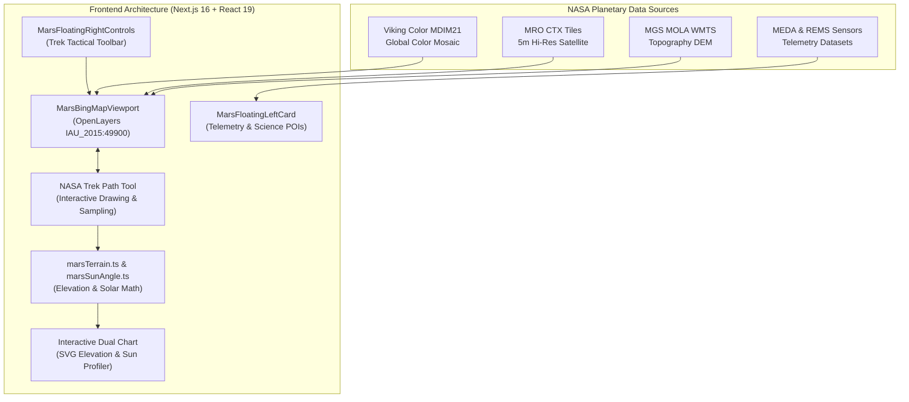

# Product Requirements Document (PRD)

## Marswalk Explorer: Integrated Planetary Mapping & EVA Navigation System

---

### Executive Metadata

* **Project Name:** Marswalk Explorer
* **Competition / Initiative:** NASA Space Apps Challenge — *Mapping Mars for Human Exploration (Marswalk)*
* **Version:** 1.0.0
* **Status:** Active / In Development
* **Primary Focus Target:** Jezero Crater (`18.44° N, 77.45° E`), Mars
* **Reference Specifications:** [CHALLENGE.md](./CHALLENGE.md), [TECHSTACK.md](./TECHSTACK.md), [WORKFLOW.md](./WORKFLOW.md)

---

## 1. Executive Summary & Problem Statement

### 1.1 Latar Belakang & Kesenjangan (Problem Statement)

Selama puluhan tahun, NASA dan badan antariksa dunia telah memetakan Mars secara robotik melalui orbiter, rover, dan lander. Data ilmiah yang dihasilkan sangat masif—mulai dari citra resolusi tinggi MRO HiRISE/CTX, topografi laser MGS MOLA, hingga data termal THEMIS dan spektrometri mineral MRO CRISM.

Meskipun alat seperti *NASA JPL Mars Trek* dan *USGS Planetary Maps* sangat kaya informasi, seluruh platform tersebut dirancang untuk sudut pandang penelitian global atau regional dari Bumi. **Belum ada antarmuka peta taktis terpadu berskala hiperlokal (*hyperlocalized*)** yang didesain khusus untuk kebutuhan langsung astronaut di permukaan Mars saat melakukan aktivitas penjelajahan di luar habitat/wahana (*Extravehicular Activity* / EVA / *Marswalk*).

### 1.2 Solusi Produk (Product Vision)

**Marswalk Explorer** adalah platform antarmuka pemetaan permukaan Mars berlapis dan sistem navigasi taktis berbasis web. Aplikasi ini mengintegrasikan data multi-misi NASA secara presisi menggunakan sistem proyeksi planet Mars (`IAU_2015:49900`), menyediakan alat perencanaan rute berbasis kemiringan lereng (*slope-aware pathfinding*), profil elevasi dan sudut datang sinar matahari interaktif, pemantauan telemetri cuaca Mars *real-time* (MEDA/REMS), serta peringatan keselamatan kru untuk menjamin *Marswalk* berjalan aman, efisien, dan kaya hasil sains.

---

## 2. Target Pengguna & Personas

| Persona                                          | Peran & Konteks Penggunaan                                                                                                     | Kebutuhan Utama                                                                                                                                                             |
| :----------------------------------------------- | :----------------------------------------------------------------------------------------------------------------------------- | :-------------------------------------------------------------------------------------------------------------------------------------------------------------------------- |
| **EVA Field Crew (Astronaut di Lapangan)** | Astronaut berbalut pakaian luar angkasa bertekanan (*spacesuit*) dengan mobilitas terbatas di atas rover atau berjalan kaki. | Antarmuka berkontras tinggi, navigasi rute bebas tebing terjal (>15°–20°), penanda *Point of No Return* (cadangan O₂ & baterai), serta inspeksi profil elevasi cepat. |
| **Hab Base / Tactical Mission Director**   | Awak pendukung di dalam habitat *Octavia E. Butler Hab Base* yang memantau pergerakan kru lapangan.                          | Pemantauan multi-layer (MOLA + CTX + Bahaya), status telemetri lingkungan (Sol, suhu, debu $\tau$, angin), dan simulasi skenario darurat (*Abort/Reroute*).             |
| **Science Operations Team**                | Peneliti sains planet yang menentukan target sampel geologi dan mineralogi.                                                    | Penanda POI mineral terhidrasi (karbonat, lempung smektit), data elevasi MOLA, dan korelasi antara target sains dan efisiensi rute tempuh.                                  |

---

## 3. Sasaran & Metrik Keberhasilan (Goals & Metrics)

### 3.1 Sasaran Utama (Key Objectives)

1. **Multi-Mission Layer Integration:** Menggabungkan minimal 3 jenis layer NASA (Citra Optik, Topografi/Elevasi, dan Mineralogi/Bahaya) dalam satu kanvas peta tanpa distorsi spasial.
2. **Terrain-Aware EVA Navigation:** Menyediakan algoritma perencanaan rute otomatis dan alat pengukuran manual (*NASA Trek Draw Tool*) yang memvalidasi tingkat kecuraman lereng (*slope*), jarak, dan estimasi waktu perjalanan.
3. **Astronaut Safety & Environmental HUD:** Menampilkan indikator keselamatan (*Go / Caution / Abort*) berbasis telemetri kondisi permukaan Mars (suhu, radiasi, badai debu) dan kalkulasi sudut pencahayaan Matahari.

### 3.2 Metrik Kinerja Produk (KPIs)

* **Akurasi Spasial:** Koordinat dan pengukuran jarak metrik mengacu pada ellipsoid bola Mars radius $R = 3.396.190\text{ m}$ tanpa asumsi WGS84 Bumi.
* **Waktu Muat Tile (Latency):** Pemuatan tile basemap WMTS di bawah 1,5 detik pada koneksi standar.
* **Performa Rendering Grafis:** Grafik profil elevasi MOLA interaktif me-render hingga 500+ titik data dalam waktu $< 100\text{ ms}$.

---

## 4. Lokasi Fokus & Skenario Misi (Mission Scenario)

* **Area Misi Utama:** **Jezero Crater** (`18.4446° N, 77.4509° E`)
  * *Markas Awal:* Octavia E. Butler Hab Base.
  * *Karakteristik Medan:* Lantai kawah vulkanik, formasi kipas delta sungai purba Neretva Vallis, lereng tebing delta (>20°), gumuk pasir Séítah (*dust trap* bahaya mobilitas), kawah tubrukan Belva, dan bukit relik Kodiak.
* **Alur Skenario Marswalk:**
  1. *Perencanaan:* Kru memilih titik berangkat (*Hab Base*) dan target sains (*Delta Scarp / Belva Crater*).
  2. *Inspeksi Medan:* Kru meninjau profil elevasi, kemiringan maksimum, dan elevasi min/max.
  3. *Eksekusi Lapangan:* Melacak jarak tempuh, sudut elevasi Matahari untuk pengisian daya surya, dan kondisi cuaca Sol.
  4. *Kontingensi:* Menerima sinyal peringatan badai debu (*dust storm*) atau bahaya radiasi untuk segera kembali ke Markas.

---

## 5. Spesifikasi Fungsional Fitur (Feature Specifications)

### 5.1 Multi-Layered Mars Cartography & Basemap Dock

* **Deskripsi:** Antarmuka pemetaan interaktif yang mendukung pergantian lapisan citra NASA Mars Trek secara instan.
* **Lapisan Basemap yang Didukung:**
  1. *Medan / Topografi:* MGS MOLA Color Shaded Relief (`Mars_MGS_MOLA_ClrShade_merge_global_463m`) — visualisasi elevasi makro dan bentang alam kawah.
  2. *Satelit Konteks Tinggi:* MRO CTX 5m Jezero Satellite Mosaic (`CTX_beta01_uncontrolled_5m_Caltech`) — detail tekstur batuan, punggungan, dan kawah sub-kilometer.
  3. *Warna Mars Asli:* Viking Color Mosaic (`Mars_Viking_MDIM21_ClrMosaic_global_232m`) — mosaik warna alami permukaan Mars.
* **Kontrol Lapisan:**
  * Popover dock horizontal ala navigasi modern dengan *thumbnail preview* visual.
  * Slider transparansi (*opacity blending*) per-layer (0% hingga 100%).

### 5.2 Standar Koordinat Planet Mars (`IAU_2015:49900`)

* **Spesifikasi CRS:**
  * Kode Resmi: `IAU_2015:49900` (EPSG:104905).
  * Radius Bola Mars: $a = b = 3.396.190\text{ meter}$.
  * Konvensi: *Planetocentric Latitude, Positive-East Longitude*.
  * Skema Tiling WMTS: Grid Equirectangular $2 \times 1$ pada level zoom 0, ukuran tile $256 \times 256$ dan $512 \times 512\text{ px}$.

### 5.3 Sistem Navigasi & Alat Ukur Jalur (EVA Route & Draw Tool)

* **Toolbar Kanan Atas Taktis:**
  * Tombol 1: **Lapisan Peta (`Layers`)** — Membuka popover dock pemilihan citra satelit/topografi.
  * Tombol 2: **Navigasi Jalur & Ukur Elevasi (`MapPin`)** — Mengaktifkan mode interaktif *NASA Trek Draw Tool*: klik di peta untuk membuat waypoint dan double-click untuk menyelesaikan rute.
  * Tombol 3: **Hapus Rute (`Trash2`)** — Tombol kontekstual aktif saat terdapat rute atau garis pengukuran untuk membersihkan peta.
  * Tombol 4: **Zoom In (`Plus`)** & Tombol 5: **Zoom Out (`Minus`)** — Kontrol skala peta metrik.
  * Tombol 6: **Reset Orientasi Utara (`Compass`)** — Mengembalikan orientasi peta ke arah kutub utara Mars.
* **Perencanaan Rute Otomatis (A\* Routing Engine):**
  * Mode Perencanaan:
    * *Safest Route:* Menghindari lereng curam ($>15^\circ$) dan zona bahaya pasir hisap (*dust trap* Séítah).
    * *Balanced Route:* Keseimbangan antara jarak terpendek dan keselamatan lereng.
    * *Max Science:* Memprioritaskan jalur yang melintasi sebanyak mungkin formasi mineral terhidrasi.

### 5.4 Panel Informasi Jalur, Profil Elevasi MOLA & Sudut Matahari

* **Panel Informasi Mengambang (Kiri Atas):**
  * Ringkasan Metrik: Total jarak tempuh ($\text{meter} / \text{km}$), estimasi durasi jalan kaki astronaut ($\sim 65\text{ m/menit}$), elevasi minimum, elevasi maksimum, total kenaikan (*ascent*), dan total turunan (*descent*).
* **Grafik Penampang Interaktif (Dual Mode Chart):**
  * *Tab Profil Elevasi:* Grafik garis area elevasi MOLA (mdpl) terhadap jarak tempuh (meter/km).
  * *Tab Sudut Matahari:* Grafik sudut elevasi Matahari ($0^\circ$ di ufuk hingga $90^\circ$ di zenit) dan proyeksi intensitas insolasi surya ($W/m^2$).
  * *Tab Gabungan (Semua):* Sinkronisasi kursor hover di grafik yang secara bersamaan menampilkan titik pin pelacak (*hover tracking marker*) langsung di atas peta spasial.

### 5.5 Modul Telemetri & Simulasi Kondisi Lingkungan Mars

* **Telemetri Misi:**
  * Waktu Misi Sol (hari matahari Mars).
  * Suhu permukaan rata-rata (mis. $-54^\circ\text{C}$ hingga $-18^\circ\text{C}$).
  * Kecepatan dan arah angin lokal (MEDA sensor).
  * Opasitas debu atmosfer ($\tau / \text{dust tau}$).
  * Status Evaluasi EVA: `GO` (kondisi aman), `CAUTION` (angin kencang/suhu ekstrem), `ABORT` (peringatan badai debu global/radiasi badai matahari).
* **Katalog Target Sains (Science POIs):**
  * Titik minat mineralogi di Jezero Crater: *Delta Front Clay*, *Carbonate Rocks*, *Séítah Olivine*, *Belva Impact Breccia*, *Kodiak Butte Relict*, dan *Neretva Valley Entrance*.
  * Informasi detail setiap target: tanda spektral mineral, formasi geologi, signifikansi astrobiologi, dan elevasi lokal.

---

## 6. Arsitektur Teknis Sistem (Technical Architecture)

---

## 7. Desain Antarmuka Pengguna & Pengalaman Pengguna (UI/UX)

* **Tema Visual:** *Aerospace Tactical Mission Control* — perpaduan palet latar belakang gelap (*deep space charcoal*) dengan panel kontrol putih solid semi-transparan berkontur tajam (*border-slate-900/90*, *shadow-2xl*).
* **Tipografi:** Sans-serif modern dan *monospace* untuk angka telemetri, koordinat, dan metrik elevasi.
* **Ergonomi Operasional:**
  * Kontrol dirancang berukuran minimal $44 \times 44\text{ px}$ agar mudah ditekan melalui layar sentuh tablet astronaut atau sarung tangan bertekanan.
  * Umpan balik visual dinamis: tombol yang sedang aktif menggambar berdenyut biru (*sky-600 animate-pulse ring*), dan marker rute memiliki garis kontras tinggi.

---

## 8. Persyaratan Non-Fungsional (Non-Functional Requirements)

1. **Kompatibilitas Lingkungan Browser:** Berjalan optimal pada browser modern (Chromium, Firefox, Safari, WebKit) tanpa memerlukan instalasi plugin eksternal.
2. **Resiliensi Operasi Lokal (Edge & Offline Readiness):** Script perhitungan lereng, sampling elevasi MOLA, dan kalkulasi sudut surya berjalan di sisi klien (*client-side TypeScript*), sehingga navigasi tetap berfungsi meski koneksi ke server pusat terputus.
3. **Efisiensi Memori & Resource:** Tile geospasial di-cache di level browser memori untuk mencegah permintaan berulang ke server NASA Trek.
4. **Keamanan & Standar Aksesibilitas:** Kompatibel dengan standar navigasi keyboard, kontrast rasio teks WCAG AA, dan tooltips informatif di seluruh tombol kendali.

---

## 9. Roadmap Pengembangan & Rencana Fase Selanjutnya

* [X] **Fase 1 (MVP — Fondasi Geospasial & Peta Multi-Layer):**
  * Konfigurasi kanvas OpenLayers CRS Mars `IAU_2015:49900`.
  * Integrasi tile WMTS NASA Trek (MOLA, Viking, CTX).
  * Toolbar kontrol taktis kanan atas dan popover pemilihan basemap.
* [X] **Fase 2 (Interaktivitas Rute & Profil Elevasi Terpadu):**
  * Pembuatan alat ukur jalur manual (*NASA Trek Draw Tool*) dengan tombol ikon Pin navigasi.
  * Sampling data elevasi real-time MOLA dan kalkulasi jarak tempuh.
  * Grafik penampang ganda interaktif: profil elevasi (mdpl) & sudut elevasi Matahari.
  * Sinkronisasi kursor grafik terhadap marker posisi di atas peta.
* [ ] **Fase 3 (Lanjutan — 3D Terrain Mesh & Backend PostGIS):**
  * Integrasi mesh 3D permukaan menggunakan Three.js untuk visualisasi mikro-kawah di sekitar titik pendaratan.
  * Penyimpanan basis data rute astronaut di PostgreSQL + PostGIS (`SRID 49900`).
  * Integrasi WebSocket untuk streaming data kondisi cuaca ekstrem real-time (*Dynamic Solar Flare & Dust Storm simulation*).
